# Clinical Study Hub on Databricks

**Business outcome.** A clinical data services organization receives study packages from sponsors (EDC exports,
central-lab files, protocol metadata). Today each package takes weeks of manual harmonization before the study team
can see its first data review. This build turns an approved package into a governed, queryable study portfolio in
minutes, with an approval gate in front of every run. Target KPIs are defined in [docs/value_model.md](docs/value_model.md).

> All data in this repository is **synthetic**. The sponsors, drugs and identifiers are invented.

## The problem

The fictional customer, Helix Clinical Research (a mid-size contract research organization), runs about 40 studies a
year. Each study starts with a package handed over by a sponsor. The data management team unzips it, maps vendor
columns to a standard clinical data model, checks it against data quality rules, and writes a status summary for the
clinical operations lead. That work is repeated per study and per vendor, and the first data review waits on it.

## The integrated data journey

```mermaid
flowchart LR
  zip["Sponsor package (zip): EDC csv, lab xlsx, protocol json"] --> landing["UC Volume: landing"]
  landing -->|"Admin approves in app"| job["Lakeflow Job: study-onboarding"]
  job --> stage["Unzip and stage (notebook)"]
  stage --> ldp["Lakeflow Declarative Pipelines: Bronze, Silver, Gold"]
  ldp --> gold["Unity Catalog: governed Gold tables"]
  gold --> insights["AI insights: ai_query (Gen AI)"]
  insights --> portfolio["study_portfolio (Delta, Change Data Feed)"]
  portfolio --> synced["Lakebase synced table"]
  gold --> genie["Genie Agent: Study Insights"]
  synced --> app["Databricks App: Study Hub"]
  genie --> app
  app --> state["Lakebase: submissions and approvals"]
  state --> job
```



Every layer is connected: the app triggers the job, the job writes governed tables, the AI and Genie read those
same tables, and the app reads the portfolio back through Lakebase.

## FE Bar layer map

| Layer | What it does | Where to look |
|---|---|---|
| Lakeflow | Ingests the package and runs Bronze to Silver to Gold | [`src/pipeline/transformations/`](src/pipeline/transformations/), [`resources/study.pipeline.yml`](resources/study.pipeline.yml) |
| Unity Catalog | Schema, volumes, governed Gold tables, comments | [`resources/`](resources/), [`src/pipeline/transformations/gold.sql`](src/pipeline/transformations/gold.sql) |
| Lakebase | Approval state, plus the portfolio served as a synced table | [`app/study-hub/server/routes/study-hub.ts`](app/study-hub/server/routes/study-hub.ts), [`00_install.py`](00_install.py) |
| ML or Gen AI | `ai_query` writes the study headline, findings and actions | [`src/notebooks/03_study_insights.py`](src/notebooks/03_study_insights.py) |
| Genie Agent | Natural-language questions over the Gold tables | [`scripts/create_genie_space.py`](scripts/create_genie_space.py) |
| Databricks App | Portfolio, onboarding, approvals, study pages, Ask Genie | [`app/study-hub/`](app/study-hub/) |
| Execution evidence | Run log, executed notebooks with outputs, query results, Genie Q&A, test output (text only) | [`evidence/RUN_LOG.md`](evidence/RUN_LOG.md) |

## Decisions and trade-offs

The reasoning behind each choice is in [docs/decisions.md](docs/decisions.md). The short version:

- Lakeflow Declarative Pipelines for the medallion layers, so quality expectations and lineage come with the pipeline.
- A Lakeflow Job with a human approval step in front of it, instead of a file watcher.
- Lakebase holds the workflow state, and a synced table serves the portfolio at operational latency. The SQL
  warehouse stays available for analytics and Genie.
- Genie Agent for natural-language questions, instead of a custom text-to-SQL layer.
- Synthetic data generated by a script that is committed with the repo, so every run can be reproduced.

## AI workflow

How the build was made, which tools and prompts were used, and where human judgment overrode the AI is documented in
[docs/ai_workflow.md](docs/ai_workflow.md).

## Run it

1. In your Databricks workspace, create a Git folder for this repository.
2. Open `00_install.py` and set `warehouse_id` (a SQL warehouse you can use). The other widgets have defaults.
3. Run All (about 15 to 20 minutes). The notebook deploys the platform bundle, processes two sample studies,
   creates the Lakebase project and synced table, creates the Genie space, and deploys the app.
4. Open the app URL from the summary cell. Upload `demo_assets/RESP-303_study_package.zip` through **Onboard a Study**,
   switch the persona to **Admin**, and approve it in **Approvals**.

Manual CLI steps are in [AGENTS.md](AGENTS.md).

## Repository layout

```
00_install.py            run this in the Git folder
AGENTS.md                instructions for Genie Code and other coding agents
databricks.yml           platform bundle
resources/               job, pipeline, schema, volumes
src/pipeline/            Lakeflow Declarative Pipelines (Bronze, Silver, Gold)
src/notebooks/           unzip and stage, AI insights, publish portfolio
src/data_gen/            synthetic study package generator
app/study-hub/           Databricks App (AppKit, React, Express)
data/samples/            generated sample packages used by the install notebook
demo_assets/             generated packages for the live demo
scripts/                 Genie space and Lakebase helpers
docs/                    decisions, value model, AI workflow
```

## Requirements

- Permission to create a Unity Catalog schema and volumes, jobs, pipelines, apps, a Lakebase project and a Genie space.
- A SQL warehouse ID you can use.
