# Clinical Study Hub on Databricks

**Business outcome.** A clinical data services organization receives study packages from sponsors (EDC exports,
central-lab files, protocol metadata). Today each package takes weeks of manual harmonization before the study team
can see its first data review. This build turns an approved package into a governed, queryable study portfolio in
minutes, with an approval gate in front of every run. Target KPIs are defined in [docs/value_model.md](docs/value_model.md).

> All data in this repository is **synthetic**. The sponsors, drugs and identifiers are invented.

## The problem

The fictional customer, Helix Clinical Research (a mid-size contract research organization), runs about 40 studies a
year. Each study starts with a package handed over by a sponsor. The data management team unzips it, maps vendor
columns to a standard clinical data model, checks it against data quality rules, and writes a status summary for the
clinical operations lead. That work is repeated per study and per vendor, and the first data review waits on it.

## The integrated data journey

```mermaid
flowchart LR
  zip["Sponsor package (zip): EDC csv, lab xlsx, protocol json"] --> landing["UC Volume: landing"]
  landing -->|"Admin approves in app"| job["Lakeflow Job: study-onboarding"]
  job --> stage["Unzip and stage (notebook)"]
  stage --> model["Mock AI data modelling (notebook)"]
  model --> gate{"Accuracy at least 99.9%?"}
  gate -->|"no, after 3 retries"| manual["Manual data modelling job (human)"]
  manual --> ldp
  gate -->|yes| ldp["Lakeflow Declarative Pipelines: Bronze, Silver, Gold"]
  ldp --> thresholds["DQ threshold check, dashboard, SQL alert"]
  ldp --> gold["Unity Catalog: governed Gold tables (clean subjects)"]
  ldp --> quarantine["Quarantine tables: failed records, kept for review"]
  quarantine --> app
  app -->|"data manager accepts issues"| remediation["Lakeflow Job: quarantine-remediation (waivers)"]
  remediation --> ldp
  gold --> insights["AI insights: ai_query (Gen AI)"]
  insights --> portfolio["study_portfolio (Delta, Change Data Feed)"]
  portfolio --> synced["Lakebase synced table"]
  gold --> genie["Genie Agent: Study Insights"]
  synced --> app["Databricks App: Study Hub"]
  genie --> app
  app --> state["Lakebase: submissions and approvals"]
  state --> job
```



Every layer is connected: the app triggers the job, the job writes governed tables, the AI and Genie read those
same tables, and the app reads the portfolio back through Lakebase.

Data quality is quarantine-first. Every record that fails a rule, and every record of its subject, moves to a
quarantine table with the reason; nothing is dropped. KPIs, the AI briefing and Genie use clean subjects only, and the
app shows the coverage next to every KPI ("97 of 124 subjects clean, 27 quarantined") plus a Quarantine tab where data
managers review each failure.

Visibility and fallbacks for the heavy automation:

- **Job alerts.** The onboarding job emails on failure and when a run takes longer than 10 minutes, and stops at 30
  minutes. The recipient is the `alert_email` bundle variable, passed at deploy and not stored in the repo.
- **AI data modelling with a human fallback.** A mock AI task maps the sponsor's columns to the standard model and
  reports value-weighted accuracy. A gate sends the run on to the pipeline at 99.9% or above (after up to 3 retries).
  Otherwise the run is handed off to a person, who completes the `manual-data-modelling` job from the app. The
  Approvals page has a simulation switch (Normal, Recover, Fail) so the demo can show each path. The AI is mocked; the
  validator and the accuracy maths are real.
- **Data quality thresholds.** Study-level metrics (percent of subjects quarantined, share of the top rule,
  reconciliation failures) are compared with warn and critical thresholds in `dq_thresholds`. The status shows as a badge
  in the app, in the AI/BI dashboard `Study Hub - data quality` and in a SQL alert that emails on critical.
- **Independent remediation.** The `quarantine-remediation` job reads the issues a data manager accepted, records them as
  waivers (an audit table), reruns the pipeline for that study and returns those subjects to Gold.

## FE Bar layer map

| Layer | What it does | Where to look |
|---|---|---|
| Lakeflow | Ingests the package and runs Bronze to Silver to Gold, with 40 data quality rules and quarantine tables | [`src/pipeline/transformations/`](src/pipeline/transformations/), [`src/pipeline/dq_rules.py`](src/pipeline/dq_rules.py), [`resources/study.pipeline.yml`](resources/study.pipeline.yml) |
| Unity Catalog | Schema, volumes, governed Gold tables, comments | [`resources/`](resources/), [`src/pipeline/transformations/gold.sql`](src/pipeline/transformations/gold.sql) |
| Lakebase | Approval state, plus the portfolio served as a synced table | [`app/study-hub/server/routes/study-hub.ts`](app/study-hub/server/routes/study-hub.ts), [`00_install.py`](00_install.py) |
| ML or Gen AI | `ai_query` writes the study headline, findings and actions | [`src/notebooks/03_study_insights.py`](src/notebooks/03_study_insights.py) |
| Genie Agent | Natural-language questions over the clean Gold tables | [`scripts/create_genie_space.py`](scripts/create_genie_space.py), [`scripts/genie_eval.py`](scripts/genie_eval.py) |
| Databricks App | Portfolio, onboarding, approvals, study pages, quarantine review, Ask Genie | [`app/study-hub/`](app/study-hub/) |
| Jobs and alerts | Onboarding job with email alerts and a timeout, AI modelling gate, manual fallback and remediation jobs | [`resources/study_onboarding.job.yml`](resources/study_onboarding.job.yml), [`resources/manual_data_modelling.job.yml`](resources/manual_data_modelling.job.yml), [`resources/quarantine_remediation.job.yml`](resources/quarantine_remediation.job.yml), [`src/lib/modelling.py`](src/lib/modelling.py) |
| Data quality visibility | Thresholds, status views, run history, dashboard and SQL alert | [`src/notebooks/05_dq_threshold_check.py`](src/notebooks/05_dq_threshold_check.py), [`resources/dq_dashboard.yml`](resources/dq_dashboard.yml), [`dashboards/`](dashboards/) |
| Execution evidence | Run log, executed notebooks with outputs, query results, data quality checks, Genie Q&A and contamination check, test output (text only) | [`evidence/RUN_LOG.md`](evidence/RUN_LOG.md) |

## Decisions and trade-offs

The reasoning behind each choice is in [docs/decisions.md](docs/decisions.md). The short version:

- Lakeflow Declarative Pipelines for Bronze, Silver and Gold, so quality expectations and lineage come with the pipeline.
- Quarantine tables instead of dropping or flagging bad records, at subject level, so nothing is lost and nothing
  unverified reaches KPIs, the AI briefing or Genie.
- A Lakeflow Job with a human approval step in front of it, instead of a file watcher.
- An accuracy gate with a human fallback after the AI step, thresholds with alerts for data quality, and a separate
  remediation job, so the automation is visible and can be taken over.
- Lakebase holds the workflow state, and a synced table serves the portfolio at operational latency. The SQL
  warehouse stays available for analytics and Genie.
- Genie Agent for natural-language questions, instead of a custom text-to-SQL layer.
- Synthetic data generated by a script that is committed with the repo, so every run can be reproduced.

## AI workflow

How the build was made, which tools and prompts were used, and where human judgment overrode the AI is documented in
[docs/ai_workflow.md](docs/ai_workflow.md).

## Run it

1. In your Databricks workspace, create a Git folder for this repository.
2. Open `00_install.py` and set `warehouse_id` (a SQL warehouse you can use). The other widgets have defaults.
3. Run All (about 15 to 20 minutes). The notebook deploys the platform bundle, processes two sample studies,
   creates the Lakebase project and synced table, creates the Genie space, and deploys the app.
4. Open the app URL from the summary cell. Upload `demo_assets/RESP-303_study_package.zip` through **Onboard a Study**,
   switch the persona to **Admin**, and approve it in **Approvals**. If RESP-303 is already published, use
   `demo_assets/DERM-404_study_package.zip`.
5. Optional checks: run [`scripts/verify_dq.sql`](scripts/verify_dq.sql) in the SQL editor (every row should report
   `failures = 0`), open the `Study Hub - data quality` dashboard, and run `scripts/genie_eval.py` to confirm no quarantined subject appears in Genie answers.

Manual CLI steps are in [AGENTS.md](AGENTS.md).

## Repository layout

```
00_install.py            run this in the Git folder
AGENTS.md                instructions for Genie Code and other coding agents
databricks.yml           platform bundle
resources/               job, pipeline, schema, volumes
src/pipeline/            Lakeflow Declarative Pipelines (Bronze, Silver, Gold) and the data quality rules registry
src/notebooks/           unzip and stage, AI data modelling, DQ thresholds, remediation, AI insights, publish portfolio
src/lib/                 mock AI data modelling logic (shared by the notebooks and the tests)
dashboards/              AI/BI dashboard for data quality
src/data_gen/            synthetic study package generator
app/study-hub/           Databricks App (AppKit, React, Express)
data/samples/            generated sample packages used by the install notebook
demo_assets/             generated packages for the live demo
scripts/                 Genie space, Lakebase and end-to-end helpers; data quality and Genie checks
tests/                   unit tests for the data quality rules registry and the modelling validator
docs/                    decisions, value model, AI workflow
```

## Requirements

- Permission to create a Unity Catalog schema and volumes, jobs, pipelines, apps, a Lakebase project and a Genie space.
- A SQL warehouse ID you can use.
